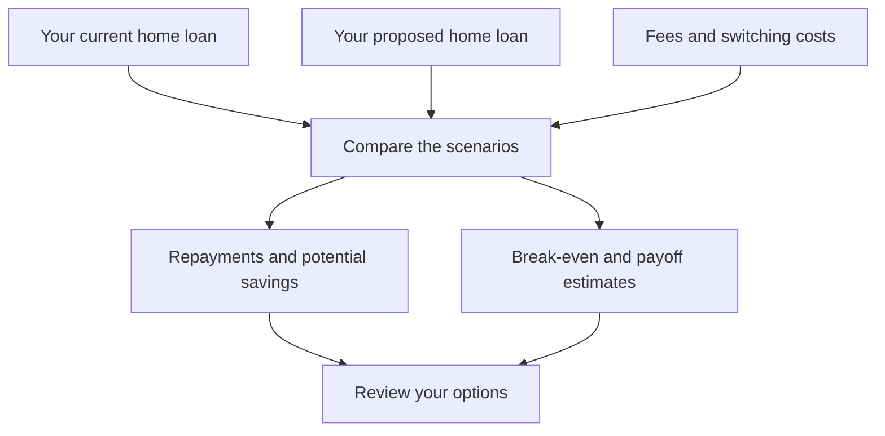
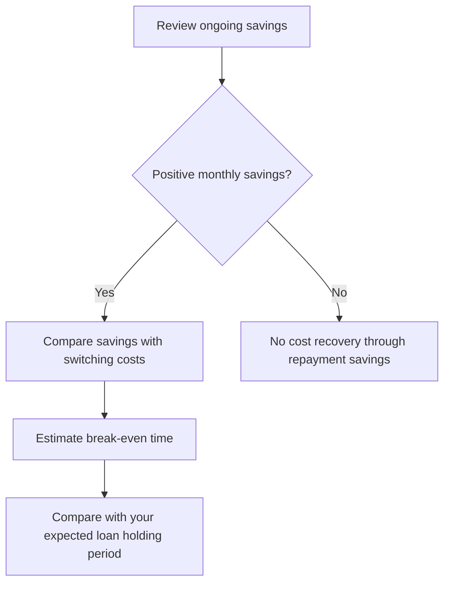

# Refinance Calculator AU | Home Loan Refinance Calculator

> Understand your repayments, compare refinance options and see how switching costs affect potential savings.

**Refinance Calculator AU is a free home loan refinance calculator for Australian residential property borrowers.** It helps you compare your current mortgage with a proposed loan, estimate potential savings, explore equity and work out how long savings could take to cover the cost of switching.

No account or contact details are needed to calculate. All amounts are in Australian dollars (AUD). Results are estimates, not lender quotes, loan approvals or personal financial advice.

[Use the refinance calculator](https://refinance.org.au/) | [Explore all calculators](https://refinance.org.au/calculators) | [Read the guides](https://refinance.org.au/guides)

## Who is the calculator for?

| Who you are | How the calculator can help |
| --- | --- |
| A homeowner reviewing an existing mortgage | Compare your current loan with a proposed rate and term |
| A borrower approaching the end of a fixed-rate period | Explore a proposed loan using your lender's confirmed switching or break costs |
| A residential property investor | Compare loan scenarios while keeping investment-specific costs and advice in mind |
| A homeowner exploring equity | Estimate your equity position and the effect of a selected loan-to-value ratio |
| A borrower comparing two offers | Look beyond the advertised rate to repayments, fees and cashback |
| Someone preparing to speak with a lender or broker | Bring a clearer picture of your numbers and the questions you need answered |

The tools focus on residential home loan refinancing in Australia. They do not assess your income, creditworthiness or eligibility for a loan.

## What problems does it solve?

| The problem | What the calculator helps you do | What you gain |
| --- | --- | --- |
| “I don't know whether a lower rate will make much difference.” | Compare current and proposed repayment estimates | A clearer view of potential cash-flow changes |
| “Switching fees could cancel out my savings.” | Include switching costs and estimate break-even | An indication of how long cost recovery could take |
| “The offers have different fees and cashback.” | Compare two offers against the same existing loan | A more consistent comparison |
| “A smaller repayment looks good, but the term is longer.” | Review the loan term alongside repayments and payoff estimates | A reason to check longer-term cost, not just the monthly payment |
| “I'm unsure how much equity I have.” | Estimate LVR, total equity and usable equity at a selected LVR | A starting point for a lender conversation |
| “I don't know where to begin.” | Follow practical guides and annotated screenshots | Clear steps and the figures to gather |

## How does the refinance calculator work?

**You enter your existing loan details and a proposed refinance scenario. The calculator uses those figures to estimate the difference in repayments, costs and potential savings.** Change the inputs to explore another scenario before making any commitment.

The comparison depends on the information you enter. Use current loan statements and written lender quotes wherever possible.

### What information do you need?

- Your outstanding home loan balance.
- Your current interest rate, remaining term and recurring fees.
- The proposed interest rate, loan term and fees.
- Your preferred repayment frequency.
- Expected switching costs and any applicable cashback.
- Your estimated property value when exploring LVR or equity.

### How do you use it?

1. **Enter your current loan.** Add your balance, rate, remaining term and relevant fees.
2. **Add the proposed loan.** Use the rate and term you want to compare.
3. **Include switching costs.** Use confirmed fees and any applicable cashback. Obtain a break-cost quote if relevant.
4. **Review the results.** Compare repayments, potential savings, break-even and payoff estimates together.
5. **Explore another scenario.** Change the proposed rate or term and see how the comparison changes.
6. **Confirm the details.** Discuss the figures, product features and eligibility with your lender or broker.

## Which calculator should you use?

| Your question | Tool |
| --- | --- |
| Could refinancing change my repayments and save money? | [Home loan refinance calculator](https://refinance.org.au/) |
| What is my loan-to-value ratio? | [Refinance LVR calculator](https://refinance.org.au/refinance-lvr-calculator) |
| How much usable equity might I have? | [How much can I refinance?](https://refinance.org.au/how-much-can-i-refinance) |
| How do two refinance offers compare? | [Compare refinance offers](https://refinance.org.au/compare-refinance-offers) |
| How long could it take to recover switching costs? | [Refinance costs and break-even calculator](https://refinance.org.au/refinance-costs-break-even-calculator) |

## Everyday use cases

### 1. You want to reduce your repayments

Compare your existing loan with a proposed lower rate using the same remaining term first. This helps you see the effect of the rate change more clearly. If you also extend the term, review the longer-term implications rather than judging the offer by its repayment alone.

### 2. You want to know whether switching is worth the upfront cost

Enter the expected switching costs and compare them with estimated ongoing savings. The break-even result helps you consider whether you expect to keep the proposed loan long enough to recover those costs.

### 3. You have two offers and one includes cashback

Use the offer comparison tool to consider repayments, fees and cashback together. Confirm the cashback conditions separately; an incentive is only relevant if you qualify for it.

### 4. You are exploring equity for a future goal

Use your estimated property value and loan balance to understand total equity. Then explore usable equity at a selected LVR. Treat the result as a starting estimate: lender valuation and borrowing assessment still apply.

### 5. Your fixed-rate period is ending

Compare your expected next loan scenario with an alternative. If you are considering leaving before the fixed period ends, obtain a current break-cost quote and include it in the comparison.

## Worked example: when could switching costs be recovered?

**If net switching costs are AUD 3,000 and ongoing savings are AUD 250 per month, simple break-even is 12 months.**

| Example figure | Amount |
| --- | ---: |
| Switching costs | AUD 3,000 |
| Cashback | AUD 0 |
| Net switching costs | AUD 3,000 |
| Assumed monthly savings after recurring fees | AUD 250 |
| Simple break-even | 12 months |
| Savings after 24 months, less switching costs | AUD 3,000 |

Calculation: **AUD 3,000 ÷ AUD 250 = 12 months.** After 24 months: **(AUD 250 × 24) − AUD 3,000 = AUD 3,000.**

This is an illustrative example, not a rate offer or a prediction. It assumes constant savings and costs paid upfront, and excludes interest on financed costs, future rate changes and the time value of money.

## What do the results mean?

| Term | Plain-language meaning |
| --- | --- |
| Repayment estimate | An estimated payment for the loan details and frequency selected |
| Potential savings | The estimated difference between the compared scenarios under the stated assumptions |
| Switching costs | Costs associated with moving from the current loan to the proposed loan |
| Break-even | The estimated time for positive ongoing savings to recover net switching costs |
| LVR | Loan-to-value ratio: loan balance divided by property value, multiplied by 100 |
| Total equity | Property value less the outstanding loan balance |
| Usable equity | An indicative amount based on the selected LVR and existing debt, subject to lender assessment |
| Payoff time | An estimate of how long repayment could take under the scenario's assumptions |

## What should you check before deciding?

A useful comparison considers more than the interest rate. Check the remaining term, recurring fees, switching costs, product features and how long you expect to keep the loan. A lower repayment can reflect a longer repayment period rather than lower overall cost.

The calculator does not predict future interest rates, guarantee a property valuation or determine loan approval. Confirm costs, eligibility and loan conditions with the lender. For independent consumer guidance, see [ASIC Moneysmart: switching home loans](https://moneysmart.gov.au/home-loans/switching-home-loans).

## Learn more about home loan refinancing

- [How to refinance a home loan](https://refinance.org.au/how-to-refinance-a-home-loan)
- [When to refinance your home loan](https://refinance.org.au/when-to-refinance-home-loan)
- [Home loan refinancing checklist](https://refinance.org.au/refinance-checklist)
- [Refinancing a fixed-rate home loan](https://refinance.org.au/refinancing-fixed-rate-home-loan)
- [Refinancing an investment property](https://refinance.org.au/refinance-investment-property)
- [How much could I save by refinancing?](https://refinance.org.au/how-much-can-i-save-refinancing-home-loan)
- [What does it cost to refinance a home loan?](https://refinance.org.au/what-does-it-cost-to-refinance-a-home-loan)
- [How much usable equity can I access?](https://refinance.org.au/how-much-usable-equity-can-i-access)
- [How to calculate home loan repayments](https://refinance.org.au/how-to-calculate-home-loan-repayments)

## Frequently asked questions

### Is Refinance Calculator AU free?

Yes. You can calculate without creating an account or providing contact details. Contacting someone about your results is a separate choice.

### Will refinancing always save me money?

No. The outcome depends on rates, fees, switching costs and the loan term. Compare the complete scenario rather than assuming a lower rate guarantees savings.

### How do I calculate refinance break-even?

Divide net switching costs by positive monthly savings. For example, AUD 3,000 in net costs divided by AUD 250 in monthly savings gives a simple break-even estimate of 12 months.

### Can I compare two refinance offers?

Yes. The [offer comparison calculator](https://refinance.org.au/compare-refinance-offers) helps you compare two proposed offers against your existing loan, including fees and cashback.

### Does an equity estimate tell me how much I can borrow?

No. An equity estimate does not establish borrowing capacity or approval. The lender must assess your circumstances, property value and application.

### Are suggested rates guaranteed offers?

No. Treat suggested rates as indicative. Confirm the rate and conditions available to you directly with a lender or broker.

### Can I use it for an investment property?

The tools include residential investment-property scenarios and a dedicated guide. They do not calculate personal tax outcomes or replace investment advice.

### Is this only for Australian home loans?

The calculator and guides focus on Australian residential home loan refinancing, with monetary examples in AUD. Lending practices and costs elsewhere may differ.

## About Refinance Calculator AU

Refinance Calculator AU combines practical comparison tools with educational guides to help borrowers understand their options before a lender conversation. The website's guides identify **Sana Hosseni** as their author. The legal publisher is **Suncorp Industries Pty Ltd**.

[Privacy policy](https://refinance.org.au/privacy-policy) | [Terms of use](https://refinance.org.au/terms-of-use) | [Financial disclaimer](https://refinance.org.au/financial-disclaimer)

**Ready to explore your numbers? [Start with the home loan refinance calculator](https://refinance.org.au/).**
