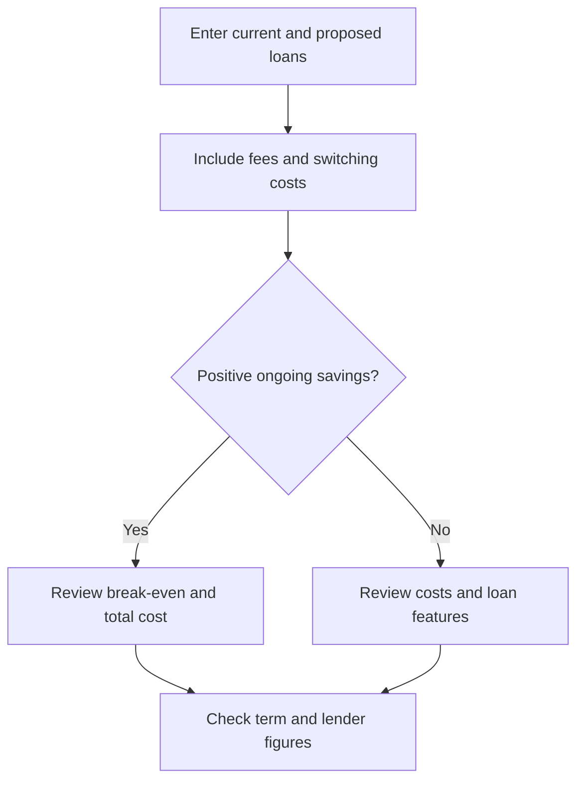
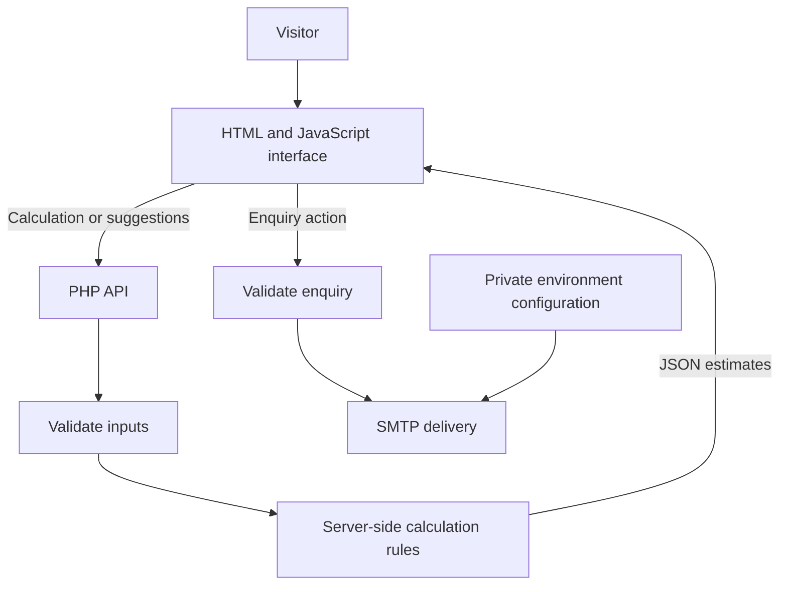
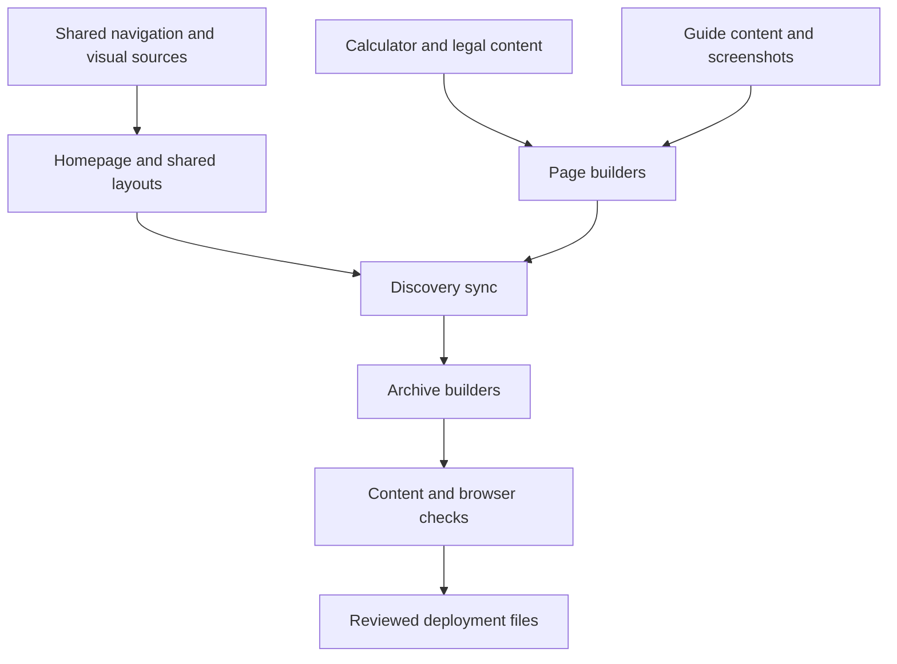

# Refinance Calculator AU | Home Loan Refinance Calculator

> Compare home loan repayments, potential refinance savings, switching costs, break-even time and usable equity for Australian residential property.

**Refinance Calculator AU** is a free home loan refinance calculator and educational guide library. It compares an existing mortgage with a proposed loan using the figures you enter. No account or contact details are required to calculate. Results are estimates, not lender quotes, loan approvals or personal financial advice.

[Open the calculator](https://refinance.org.au/) · [Browse calculators](https://refinance.org.au/calculators) · [Read refinancing guides](https://refinance.org.au/guides)

| Project fact | Details |
| --- | --- |
| Audience | Australian residential home loan borrowers |
| Currency | Australian dollars (AUD) |
| Public brand | Refinance Calculator AU |
| Editorial author | Sana Hosseni |
| Legal publisher | Suncorp Industries Pty Ltd |
| Canonical domain | https://refinance.org.au/ |
| Primary implementation | Static HTML, CSS and JavaScript with a PHP calculation endpoint |
| Documentation reviewed | 23 November 2026 |

The links above identify the intended canonical website. This README documents the local source; it does not certify the current deployment status of that domain. A separate [hosted edition](https://refinance-calculator-au.alidye.chatgpt.site/) has its own adapter and deployment workflow.

## Contents

- [What can you calculate?](#what-can-you-calculate)
- [How do you use the refinance calculator?](#how-do-you-use-the-refinance-calculator)
- [How is refinance break-even calculated?](#how-is-refinance-break-even-calculated)
- [Architecture and data flow](#architecture-and-data-flow)
- [Run the project locally](#run-the-project-locally)
- [Maintain and regenerate content](#maintain-and-regenerate-content)
- [SEO, AEO and GEO](#seo-aeo-and-geo)
- [Deploy to Hostinger](#deploy-to-hostinger)
- [Frequently asked questions](#frequently-asked-questions)
- [Sources and ownership](#sources-and-ownership)

## What can you calculate?

| Tool | Question it answers | Link |
| --- | --- | --- |
| Home loan refinance calculator | How do my current and proposed loans compare after fees and switching costs? | [Compare refinancing](https://refinance.org.au/) |
| Refinance LVR calculator | What is my loan-to-value ratio and equity position? | [Calculate LVR](https://refinance.org.au/refinance-lvr-calculator) |
| How much can I refinance? | What loan amount and usable equity correspond to a selected LVR? | [Estimate usable equity](https://refinance.org.au/how-much-can-i-refinance) |
| Compare refinance offers | How do two proposed offers compare with my existing loan? | [Compare offers](https://refinance.org.au/compare-refinance-offers) |
| Refinance costs and break-even | How long could repayment savings take to recover switching costs? | [Estimate break-even](https://refinance.org.au/refinance-costs-break-even-calculator) |

The guide library contains nine articles covering the refinancing process, investment properties, timing, checklists, fixed-rate loans, savings, costs, usable equity and repayment calculations. Guides include visible instructions, annotated calculator screenshots, sources and related tools.

## How do you use the refinance calculator?

1. Gather your current loan balance, interest rate, remaining term and recurring fees.
2. Enter the proposed loan details and choose the applicable repayment frequency.
3. Add switching costs and any applicable cashback using written figures where available.
4. Compare repayment estimates, savings, break-even and payoff time. Check whether a longer term explains a lower repayment.
5. Review the assumptions and obtain lender confirmation before making a decision.



The decision diagram describes how to interpret the comparison. It is not a lending eligibility test.

## How is refinance break-even calculated?

**Simple break-even in months equals net switching costs divided by positive monthly savings.** This estimates when ongoing savings recover the initial cost of switching.

| Illustrative input | Amount |
| --- | ---: |
| Switching costs | AUD 3,000 |
| Cashback | AUD 0 |
| Net switching costs | AUD 3,000 |
| Assumed monthly savings after recurring fees | AUD 250 |
| Simple break-even | 12 months |
| Savings after 24 months, less switching costs | AUD 3,000 |

Arithmetic: `3,000 / 250 = 12 months`; `(250 × 24) − 3,000 = 3,000`.

This original example assumes constant savings and costs paid upfront. It excludes interest on financed costs, future rate changes and the time value of money. It is not a rate offer or an API test result. Zero or negative savings cannot recover a positive switching cost through repayment savings alone.

Other useful definitions:

- **LVR:** loan balance divided by property value, multiplied by 100.
- **Total equity:** property value less outstanding loan balance.
- **Indicative usable equity:** property value multiplied by the selected LVR, less existing debt, subject to lender assessment and applicable costs.

For consumer guidance on fees and loan-term comparisons, see [ASIC Moneysmart: switching home loans](https://moneysmart.gov.au/home-loans/switching-home-loans).

## Architecture and data flow

The primary site needs no frontend framework, package manager or compilation step. The homepage and comparison widget call `calculator-api.php`; the supporting LVR, equity and break-even widgets use browser arithmetic.



The PHP endpoint dispatches by the JSON `action` field:

| Request | Behaviour |
| --- | --- |
| No action | Validate inputs and calculate the loan comparison |
| `suggestions` | Return indicative rate suggestions |
| `lead` | Validate an enquiry and send email through SMTP |

The API requires POST and JSON. It returns HTTP 405 for other methods, 415 for unsupported content types, 400 for malformed JSON and 422 for validation errors. Loan terms must be whole years from 1 to 40; rates must be between 0% and 20%; balances must be positive.

Keep pricing thresholds, upfront-estimate rules and lead eligibility on the server. Inputs, returned results and API responses remain visible to the visitor. Server-side logic does not make public responses confidential.

### Where the files live

| Path | Role |
| --- | --- |
| `refinance-calculator-hostinger/refinance-calculator/` | Source of truth and deployable web root |
| `index.html` inside the web root | Homepage markup, styles, application and structured data |
| `calculator-api.php` inside the web root | Calculation, suggestions, validation and enquiry delivery |
| `assets/` inside the web root | Shared styles, scripts, photos, screenshots and SVG assets |
| Root Python scripts | Content and shared-layout generators |
| `tests/` | Static, API, browser and content checks |
| `preview-router.php` | Local extensionless routing and redirects |
| `sites/refinance-calculator-au/` | Separate hosted edition; preserve its calculator/contact adapter |
| `refinance-calculator-standalone/` | Optional generated mirror, when present |
| Root `refinance-calculator.html` | Historical prototype, not the deployable site |

## Run the project locally

Use PHP with a local server, Python with `beautifulsoup4`, and Python Playwright with Chromium for browser tests. The package documents PHP 7.4+ compatibility; use a currently supported PHP release for production.

From this project directory, install the Python test dependencies if missing:

```powershell
python -m pip install beautifulsoup4 playwright
python -m playwright install chromium
```

Start the preview and leave it running:

```powershell
php -S 127.0.0.1:8766 -t refinance-calculator-hostinger/refinance-calculator preview-router.php
```

Open http://127.0.0.1:8766/. In another terminal, validate changes:

```powershell
python -m unittest discover -s tests -p 'test_*.py' -v
python verify-seo-release.py
```

Installed-browser smoke tests additionally require Chrome and Edge. **Never submit a complete `lead` request in tests or manual checks: it sends a real email.** Use existing validation-only or mocked-delivery tests.

## Maintain and regenerate content

Edit the generators for generated pages, rather than their HTML outputs. The optional standalone mirror is copied automatically and must not be edited directly.



| Change | Source or workflow |
| --- | --- |
| Shared navigation | `site_navigation.py`, `assets/navigation.css`, `assets/navigation.js` |
| Homepage visual sections | `visual_components.py`, `content_layouts.py`; run `build-visual-page.py` after navigation |
| Supporting calculators | `build-calculator-pages.py`; bump asset versions when changing `tools.css` or `tools.js` |
| Legal copy | `build-legal-pages.py`; update its `UPDATED` value |
| Original five guides | `guide_content.py`; run `build-guide-pages.py` |
| Question-led guides | `question_guide_content.py`, `repayment_guide_content.py`; run `build-intent-guides.py` |
| Guide and calculator archives | `build-guides-archive.py`, `build-calculator-archive.py` |
| Discovery exports and optional mirror | `sync-discovery-assets.py` |
| Hosted edition content sync | `sync-guides-archive-to-sites.py`; this is not a deployment command |

For a full shared-content refresh, run these from the workspace root, then run the validation commands above:

```powershell
python site_navigation.py
python build-visual-page.py
python build-calculator-pages.py
python build-legal-pages.py
python build-guide-pages.py
python build-intent-guides.py
python sync-discovery-assets.py
python build-calculator-archive.py
python build-guides-archive.py
```

On Windows, `py -X utf8` can replace `python` if console encoding causes problems. Run `capture-guide-screenshots.py` only when the illustrated calculator interfaces change, then rebuild the affected guides. Preserve image credits in `assets/articles/photo-credits.txt`.

Keep article authorship as Sana Hosseni, legal publisher details separate, article hero bylines intact and archive heroes without author metadata. Preserve keyboard controls, reduced-motion behaviour, no-JavaScript instructional content and carousel pause-on-hover/focus behaviour.

## SEO, AEO and GEO

This README uses a descriptive title, direct answers, meaningful links, defined entities, explicit assumptions and sourced explanations. **SEO** means search engine optimisation; **AEO** means answer engine optimisation; **GEO** means generative engine optimisation.

| Area | Implementation and maintenance |
| --- | --- |
| Search intent | Organise content around refinance savings, costs, LVR, usable equity and repayments |
| Crawlable content | Keep important instructions and answers in HTML, including without JavaScript |
| Canonical URLs | Use `https://refinance.org.au/` consistently in the primary edition's canonicals, sitemap and schema |
| Internal discovery | Link existing tools and guides through menus, archives and contextual cards |
| Answer clarity | Put a concise answer beneath each question heading; explain units and assumptions |
| Entity consistency | Use Refinance Calculator AU, Sana Hosseni and Suncorp Industries Pty Ltd in their distinct roles |
| Structured data | Keep Article, BreadcrumbList, FAQ and genuine HowTo content aligned with visible text |
| Evidence | Retain source links, accurate update dates, original examples and screenshot descriptions |
| AI-readable companions | Regenerate `llms.txt` and Markdown companions alongside visible source content |

Google states that its AI search features require no special AI files or additional schema. Existing SEO fundamentals apply, and inclusion is not guaranteed. See [Google's AI features guidance](https://developers.google.com/search/docs/appearance/ai-features) and [SEO Starter Guide](https://developers.google.com/search/docs/fundamentals/seo-starter-guide).

A local README does not itself change live page metadata, indexing or rankings. The primary site's Markdown companions are served with `noindex, follow`; they support documentation rather than compete with the HTML pages. Keep essential answers on indexable HTML pages. FAQ and HowTo markup must not be described as a promise of rich results or AI citations.

The supplied Australian keyword dataset is dated **29 October 2026** and lives in `keyword-research/imports/`. Its metrics are provider estimates, not current traffic measurements. Do not relabel cached research as fresh keyword data.

## Deploy to Hostinger

1. Back up the existing web root and confirm that the generated files and required checks are ready.
2. Upload the **contents** of `refinance-calculator-hostinger/refinance-calculator/` to `public_html`, including `.htaccess` and assets.
3. Configure SMTP through `REFINANCE_SMTP_*` environment variables or a private `.env` one directory above `public_html`. Never include `.env` in the web root or deployment ZIP.
4. Confirm PHP execution, HTTPS, extensionless routes, redirects and genuine HTTP 404 responses.
5. Verify the sitemap, canonical URLs, calculator operation and responsive navigation on the deployed host. Submit the canonical sitemap in Search Console when the intended domain is live.

SMTP environment variables take precedence over `.env`. File values must be unquoted and have no inline comments. Do not print or commit passwords. Missing SMTP configuration affects enquiries, not calculation functionality.

The primary `.htaccess` canonical redirects target the production hostname while allowing the Hostinger temporary domain to operate. Share links and API calls use the active host. The separate hosted edition must retain its email/phone enquiry adapter and its own origin handling.

## Frequently asked questions

### Is the refinance calculator free?

Yes. The calculator can be used without an account or contact details. An enquiry is a separate action.

### Will refinancing always save money?

No. A lower interest rate or repayment does not establish overall savings. Switching costs, recurring fees and a longer loan term can change the outcome. Compare costs over a consistent period and check lender figures.

### Does usable equity mean I can borrow that amount?

No. It is an estimate based on property value, debt and the selected LVR. Lender valuation, serviceability and lending criteria determine any approved amount.

### Are suggested rates live lender offers?

Treat suggestions as indicative outputs from the application's rules. They are not a live market-wide quotation service or a guarantee of eligibility.

### Is this a WordPress plugin?

No. The primary edition is a standalone static and PHP site. It can run on compatible PHP hosting without WordPress.

### Can I deploy only the HTML files?

No. The primary calculator requires `calculator-api.php`. Preserve the assets and routing configuration as well. A static-only host cannot execute this PHP endpoint.

### Will this README improve Google or AI visibility automatically?

No. It provides clear, reusable documentation. Public discovery also depends on the deployed website being accessible, indexable, useful and trustworthy. Neither rankings nor AI citations are guaranteed.

## Sources and ownership

- [ASIC Moneysmart: switching home loans](https://moneysmart.gov.au/home-loans/switching-home-loans): consumer context for costs and comparisons.
- [Google Search Central: SEO Starter Guide](https://developers.google.com/search/docs/fundamentals/seo-starter-guide): search documentation practices.
- [Google Search Central: AI features and your website](https://developers.google.com/search/docs/appearance/ai-features): AI search eligibility and content guidance.
- Local implementation: `calculator-api.php`, page generators, `AGENTS.md`, `.htaccess` and discovery files, inspected for this README on 23 November 2026.

The website identifies Sana Hosseni as its editorial author and Suncorp Industries Pty Ltd as its legal publisher. This technical README does not imply editorial review by that author. Preserve existing author IDs, profile links, image paths and photo licence records. Do not assume an open-source licence or unrestricted redistribution rights.

Mermaid-capable Markdown viewers render the two flow diagrams and maintenance diagram above. Their surrounding text also explains the same workflows when diagram rendering is unavailable.

